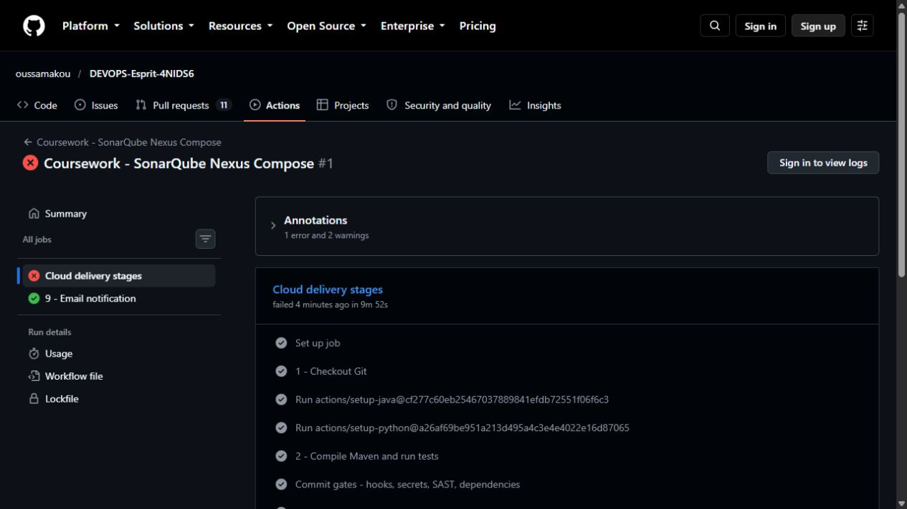

# First Azure Compose deployment: failure and repair

The [first full delivery run](https://github.com/oussamakou/DEVOPS-Esprit-4NIDS6/actions/runs/39883066388)
failed at stage 7 on 23 October 2026. Checkout, Maven tests, commit security gates,
SonarQube, Nexus, image scanning, OIDC login and ACR publishing passed. Stage 8 was
skipped; the failure notification was accepted by Gmail SMTP. Inbox receipt was
not checked.

## Observed causes

SSH inspection of the deployed VM confirmed two independent configuration errors:

1. The app started, connected to MySQL and returned `[]` from inside its container.
   Its requested `127.0.0.1:8089` binding had no actual Docker port mapping because
   both attached networks were internal. The host's request returned connection
   refused. The database-backed API readiness check correctly rejected delivery.
2. The private deployment umask and archive modes left tracked configurations
   root-owned with mode `0600`. Prometheus logged
   `open /etc/prometheus/prometheus.yml: permission denied`; Grafana reported the
   same error for its dashboard provisioning file. Both containers restarted.

Azure's Run Command wrapper reported `ProvisioningState/succeeded`, but the
deployment checker rejected the missing application success marker. An Azure
request completing does not prove that the application deployed successfully.

## Repair and live verification

The app, Prometheus and Grafana now also attach to a normal bridge named
`host_access`, allowing Docker to install their explicitly localhost-only port
bindings. MySQL remains unpublished on the internal database network. The private
metrics network remains internal; the three host-access services now also have
outbound connectivity through their extra bridge. Public inbound application and
monitoring access remains closed; use the owner's SSH tunnel.

The deployment installs tracked, non-secret configurations as `0644` so container
users can read them. Generated credentials remain in the root-only `0600` `.env`;
passwords and persistent database volumes are preserved across deployments.
Readiness failures now identify the failed check and print container state/port
information without dumping secret environment variables.

The corrected deployment bundle was run on the Azure VM against the exact first
scanned ACR digest (`sha256:1d836d05a8ad9c9d1461c7f3112bf903d0f289338c905b7fb461727725ca4a03`).
It returned `DEPLOY_SUCCEEDED compose-deploy`; the independent monitoring bundle
returned `MONITORING_VERIFIED: Prometheus student-api UP and Grafana database ok`
and `DEPLOY_SUCCEEDED compose-monitor`. A full Actions rerun is the separate
end-to-end confirmation after merging the repair.

The offline Compose validation now rejects published services attached only to
internal networks, non-localhost port bindings and an externally attached or
published MySQL service. These checks supplement the actual Azure readiness test.

Docker documents the network behavior in
[Networking in Compose](https://docs.docker.com/compose/how-tos/networking/)
and [port publishing](https://docs.docker.com/engine/network/port-publishing/).

## Separate CI image-import failure during repair validation

[Repair validation run 39884680576](https://github.com/oussamakou/DEVOPS-Esprit-4NIDS6/actions/runs/39884680576)
passed the source, dependency and infrastructure checks, then failed its disposable
k3s integration test. The importer printed success, but the pod could not find the
locally built image and fell back to Docker Hub, producing `ImagePullBackOff` and
`pull access denied`. This did not affect the running Azure Compose application.

The test now imports the exact build archive directly into the node's containerd
and checks the CRI image ID against Docker's build ID before creating workloads.
Only the disposable CI manifest uses `imagePullPolicy: Never`, so a missing local
artifact fails instead of falling back to an unrelated registry. Production
manifests and Azure ACR authentication retain their existing behavior.
