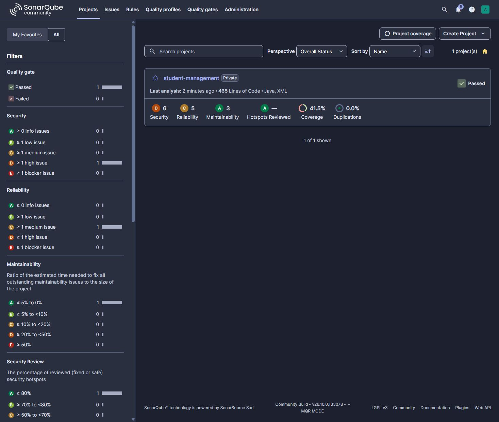
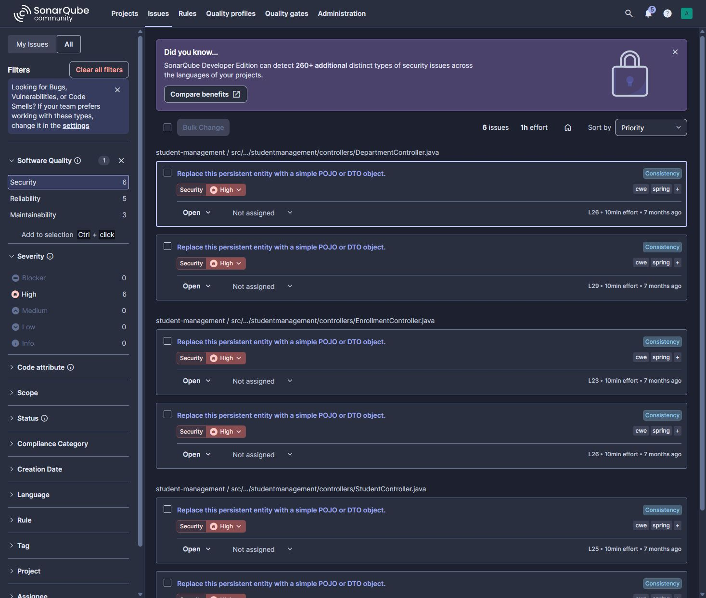

# First live SonarQube analysis

The first coursework delivery analyzed commit
`aebf8e24ec0d55ad27a7f5181d098de4f9496e65` on 23 October 2026 in
[run 39883066388](https://github.com/oussamakou/DEVOPS-Esprit-4NIDS6/actions/runs/39883066388).
The analysis report completed successfully and the existing quality gate returned
`OK`. This is a first baseline, not a claim that the application has no issues.

## Findings actually reported

SonarQube reported 11 open issues. Six have HIGH security impact; five have MEDIUM
reliability impact, with three of those also affecting maintainability. Overall
coverage was 41.5%. No findings were marked false positive or suppressed.

| Rule | Count | Affected code | Meaning |
| --- | --- | --- | --- |
| `java:S4684` | 6 HIGH security | Create/update request bodies in StudentController, DepartmentController and EnrollmentController | Persistent JPA entities are bound directly to untrusted JSON; use explicit request DTOs and server-controlled mapping to limit over-posting |
| `java:S3655` | 2 MEDIUM reliability | DepartmentService and EnrollmentService | An Optional is accessed without handling a missing record |
| `java:S6813` | 3 MEDIUM reliability/maintainability | StudentService, DepartmentService and EnrollmentService | Prefer constructor injection over field injection |

The entity-binding alerts identify a potential mass-assignment risk. This analysis
did not demonstrate an exploit or prove authorization bypass. The records were
already present in the repository; no defects were added to manufacture findings.

## Why the gate passed

The first baseline gate response was `status=OK`, `conditions=[]`,
`ignoredConditions=false`, `caycStatus=compliant`. The default gate evaluates new
code; this initial analysis did not provide evaluated conditions for the baseline.
Do not present its green status as overall security or 80% overall coverage.
The workflow did wait for the real gate response; it did not ignore a failed gate.

The lab API remains behind an owner-only SSH tunnel and is for synthetic data.
Before using real student data or exposing it publicly, remediate the request DTO
findings, add authentication/authorization and request validation, and review an
overall-security gate or explicitly documented baseline policy. Improve tests for
the missing-record cases and the relevant input boundaries.

Keep this baseline evidence alongside a later remediation commit and passing
rescan. It is an open finding record, not a completed remediation case study.
