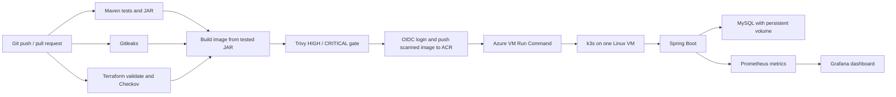

# Azure DevSecOps lab: Spring Boot on k3s

An extension of Oussama Koudhai's existing Esprit student-management project.
The original Jenkins/Minikube implementation is preserved in
[`LEGACY-JENKINS-MINIKUBE.md`](LEGACY-JENKINS-MINIKUBE.md). The Java API and
its history remain the starting point; the Azure path is new work.

**Implementation is provided; Azure deployment and performance claims require actual runs.**
See [`VALIDATION.md`](VALIDATION.md) for checks performed on this machine and
[`../evidence/README.md`](../evidence/README.md) for what to measure.

## Start locally (Windows PowerShell)

Prerequisites: Git, Java 17, Docker Desktop with Linux containers and WSL2.
Maven Wrapper is included. Docker must be running, not just installed.

```powershell
# From the repository root
.\mvnw.cmd -B -ntp verify
powershell -ExecutionPolicy Bypass -File scripts/setup-local.ps1
docker compose up --build -d
docker compose logs -f app
```

`setup-local.ps1` generates a private `.env` with separate random database
passwords. MySQL uses a dedicated `student` application user and is not published
on a host port. An existing old Compose volume keeps its old database users and
passwords: see the troubleshooting guide before reusing it.

```powershell
Invoke-RestMethod http://localhost:8089/student/students/getAllStudents
Invoke-RestMethod http://localhost:9090/actuator/health/readiness
(Invoke-WebRequest http://localhost:9090/actuator/prometheus).Content
# Stop containers while preserving database data:
docker compose down
```

Swagger UI: `http://localhost:8089/student/swagger-ui/index.html`.
Do not expose this unauthenticated application or put real personal information in it.

## Architecture



The same image tar is scanned and published, then selected by immutable digest.
Only master can deploy, after all gates pass and deployment is explicitly enabled.
GitHub does not need inbound SSH or Kubernetes API access. It uses Azure Run Command
with a scoped, root-equivalent permission on the lab VM. The VM uses its own managed
identity to renew registry pull credentials hourly.

## Six pipeline stages

| Stage | Purpose | Failure behavior |
| --- | --- | --- |
| 1. Maven | Compile, test, package; cache dependency downloads | Any failed build or test blocks the image build |
| 2. Gitleaks | Scan Git history for secrets; redact evidence | New finding blocks delivery |
| 3. Checkov | Scan Terraform; also fmt, validate and workflow lint | Any unexcepted policy violation blocks delivery |
| 4. Docker | Build Linux amd64 image from the tested JAR; cache layers | Build failure blocks scanning/deploy |
| 5. Trivy | Scan OS and Java packages in the final application image | Any HIGH/CRITICAL finding blocks delivery, including unfixed findings |
| 6. Deploy | Push exact scanned image; apply manifests; wait; smoke test | A failed rollout or API check fails the job |

The first three jobs run in parallel. There are six logical stages, not six
unnecessarily serial jobs. No cloud credentials are needed for PR validation.
Deployment remains skipped until the Azure setup is completed. Nothing is applied
to Azure automatically by the Terraform validation job.

The Docker stage also starts a disposable k3s cluster using k3d on the GitHub runner.
It tests the actual image/manifests, API writes/reads, persistence after MySQL pod
replacement and a Prometheus scrape. This requires no Azure account, and does not
verify Azure provisioning, VM identity or the Azure-specific deployment script.

## Read in this order

1. [`LEARNING-AND-INTERVIEW.md`](LEARNING-AND-INTERVIEW.md): concepts and real code paths.
2. [`AZURE-SETUP.md`](AZURE-SETUP.md): account, costs, provisioning and OIDC configuration.
3. [`OPERATIONS.md`](OPERATIONS.md): deployment checks, metrics, backups and rollback.
4. [`../SECURITY.md`](../SECURITY.md): exact gates, trust boundaries and exceptions.
5. [`../evidence/README.md`](../evidence/README.md): measure before updating the CV.

The initial multi-stage Dockerfile already existed. Do not present that as a new
change, or claim 14-to-5-minute deployments / 480-to-190-MB images without evidence.
This lab has one VM, local database storage, ephemeral monitoring history and no API
authentication or public TLS. It is not a highly available production deployment.
